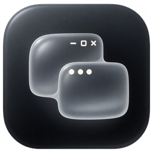

# Seam

<p align="center"></p>

[](https://github.com/pkozubski/seam/actions/workflows/ci.yml)
[](https://github.com/pkozubski/seam/releases/latest)

Współdzielenie **klawiatury i myszy**, **schowka** oraz **dźwięku** między Windows a macOS
po sieci lokalnej – bez sterowników, konta i chmury, z uwierzytelnionym szyfrowaniem.

Scenariusz, na który jest zbudowana ta wersja:

* **Windows → Mac**: fizyczna klawiatura i mysz podpięte do Windowsa sterują Makiem
  (kursor przechodzi przez krawędź ekranu jak w Synergy/Barrier).
* **Mac → Windows**: cały dźwięk systemowy Maca gra na słuchawkach/głośnikach Windowsa.
* **Okna Maca na Windowsie** (eksperymentalne): przeciągnij okno na Macu w stronę Windowsa,
  a pojawi się na pulpicie Windows obok zwykłych okien i będzie działać zwykłym kursorem.
  Alternatywnie cały pulpit Maca na monitorze Windows.
  Szczegóły w sekcji [Ekran wirtualny](#ekran-wirtualny-maca-na-windowsie).
* **Schowek w obie strony**: kopiuj i wklejaj tekst, zdjęcia i zrzuty ekranu
  między komputerami (bez przełączania kursora). Zmiany wykrywamy co ok. 0,5 s;
  czas przesłania obrazu zależy od jego wielkości i sieci.
* **Autostart**: obie aplikacje mogą uruchamiać się przy logowaniu i czekać w tle
  (pasek menu / zasobnik).

```
┌──────────────── Windows ────────────────┐        ┌──────────────── macOS ─────────────────┐
│ hooki WH_MOUSE_LL / WH_KEYBOARD_LL      │  TCP   │ NWListener :47800                      │
│ → AES-256-GCM → TcpClient (NODELAY)     │ ─────▶ │ → CGEvent (mysz, klawiatura)           │
│                                         │        │                                        │
│ UDP :47802 → AES-GCM → jitter → WASAPI  │ ◀───── │ Core Audio process tap (14.2+) → UDP   │
│ (NAudio, shared/exclusive)              │  UDP   │ szyfrowany PCM 16-bit, ~5 ms/pakiet     │
│                                         │        │                                        │
│ broadcast "BLM2?" → lista Maców         │ ◀───── │ odpowiedź discovery :47801              │
│ schowek (GetClipboardSequenceNumber)    │ ◀────▶ │ schowek (NSPasteboard.changeCount)      │
└─────────────────────────────────────────┘        └────────────────────────────────────────┘
```

Połączenie wymaga kodu z Maca. Wzajemne uwierzytelnienie HMAC-SHA-256 tworzy dla każdej
sesji osobne klucze sterowania i audio; licznik pakietów blokuje ich ponowne odtworzenie.
Szczegóły: [docs/PROTOCOL.md](docs/PROTOCOL.md), [polityka bezpieczeństwa](SECURITY.md) i
[informacja o prywatności](PRIVACY.md).

## Wymagania

| | |
|---|---|
| macOS | 14.2 lub nowszy (Core Audio taps). Uprawnienia: **Dostępność** i **Nagrywanie dźwięku systemowego**. |
| Windows | Windows 10/11 x64. Plik `Seam-Windows-x64.exe` z [Releases](https://github.com/pkozubski/seam/releases/latest) nie wymaga instalowania .NET. |
| Sieć | Obie maszyny w tej samej sieci LAN (najlepiej kabel; Wi‑Fi też działa). |

## Pobieranie

Gotowe pliki są w [GitHub Releases](https://github.com/pkozubski/seam/releases/latest):

* `Seam-macOS.zip` – uniwersalna aplikacja (Apple Silicon + Intel). Rozpakuj i przenieś
  do `~/Applications` (auto-updater potrzebuje prawa zapisu do katalogu aplikacji).
* `Seam-Windows-x64.exe` – pojedynczy plik, bez instalatora.
* `SHA256SUMS.txt` – sumy kontrolne używane też przez updater.
* pliki `*.sig` – podpisy ECDSA weryfikowane przez obie aplikacje.

Obecne wydanie jest bezpłatną betą. Przy pierwszym uruchomieniu Windows może pokazać
„Unknown publisher” – wybierz **More info → Run anyway**. Na macOS użyj
**Ustawienia systemowe → Prywatność i ochrona → Otwórz mimo to**. Nie wyłączaj globalnie
SmartScreen ani Gatekeepera. Publiczne wydanie komercyjne docelowo otrzyma Apple Developer
ID z notarizacją oraz zaufany podpis Windows.

## Autostart

Przełącznik **Uruchamiaj przy logowaniu** jest w karcie „Ustawienia” (macOS) i w grupie
„Uruchamianie” (Windows). Stan jest czytany z systemu, więc zgadza się z tym, co widać
w ustawieniach systemowych, nawet po ręcznej zmianie.

| | Mechanizm | Gdzie to widać |
|---|---|---|
| macOS | `SMAppService.mainApp` (element logowania). Gdy system go odrzuci, aplikacja instaluje LaunchAgent w `~/Library/LaunchAgents/com.borderlessmouse.mac.login.plist`. | Ustawienia systemowe → Ogólne → Elementy logowania |
| Windows | Wpis `Seam` w `HKCU\Software\Microsoft\Windows\CurrentVersion\Run` (bez uprawnień administratora). | Menedżer zadań → Aplikacje autostartu |

Przy starcie z logowania aplikacja domyślnie nie otwiera okna: macOS pokazuje tylko ikonę
w pasku menu, Windows tylko ikonę w zasobniku (można to wyłączyć obok przełącznika
autostartu). Wpis autostartu jest automatycznie poprawiany, jeśli plik aplikacji zmieni
ścieżkę, np. po przeniesieniu folderu.

Diagnostyka: `Seam.app/Contents/MacOS/Seam --login-item-test` włącza
autostart, wypisuje użyty mechanizm i przywraca poprzedni stan.

## Interfejs

Przy pierwszym uruchomieniu obie aplikacje prowadzą przez parowanie i wymagane zgody.
Interfejs używa polskiego dla polskiego języka systemu, a angielskiego dla pozostałych.
Wersja testowa seam ma wspólny grafitowy ekran główny, szklane okna i srebrne ikony 3D.
Pasek boczny zawiera Połączenie, Sterowanie, Dźwięk, Schowek, Okna, Ustawienia i Dziennik
oraz Uprawnienia na Macu. Okrągły status wystaje poza dolną krawędź okna i otwiera
szczegóły połączenia; przy krawędzi ekranu pozostaje w dostępnym obszarze.

* macOS: SwiftUI `NavigationSplitView`, systemowe przełączniki i przyciski, osobny panel
  szybkich ustawień w pasku menu. Status jest przypiętym oknem `NSPanel`.
* Windows: FluentAvalonia `NavigationView` i kontrolki Fluent. Komunikaty o aktualizacji
  i uprawnieniach pozostają nad stroną, a status jest przezroczystym oknem podrzędnym.

Wygląd kontrolek na Macu zależy od SDK, z którym zlinkowano aplikację: build z SDK macOS 26
dostaje na Tahoe nowy wygląd systemu (szklane przełączniki, pigułkowe przyciski), starszy SDK
daje tryb kompatybilności sprzed Tahoe. `build.sh` wybiera najnowszy SDK z Command Line Tools
i Xcode, a CI buduje na `macos-26` z wymogiem `REQUIRE_SDK_MAJOR=26`.

Podgląd wyglądu bez uruchamiania sieci i uprawnień:

* macOS: `Seam.app/Contents/MacOS/Seam --ui-preview zrzut.png
  [--ui-section connection|permissions|control|audio|clipboard|windows|settings|log]` – okno pojawia się na
  ekranie na około sekundę (sidebar i toolbar renderuje dopiero kompozytor).
* Windows: `Seam.exe --screenshot zrzut.png` (zapisuje pierwszą stronę pod tą
  nazwą, a pozostałe jako `zrzut-control.png`, `zrzut-settings.png`, `zrzut-log.png`).

W tym trybie aplikacja nie łączy się z niczym i pokazuje przykładowe dane. Podgląd macOS
używa fikcyjnego kodu parowania i nie zapisuje zmian ustawień. `--ui-compact` wybiera
mniejsze okno, `--ui-disconnected` brak połączenia, `--ui-missing-permissions` brak zgód,
a `--ui-menu` i `--ui-onboarding` panel menu i kreator. `--ui-interactive` pozostawia
okno do ręcznej kontroli UI. Ekran główny ma ciemny motyw zgodny z projektem seam.
Podglądy obejmują także wystający status połączenia.

Zakładka **Okna** pokazuje przejście dowolnego okna przez wspólną krawędź ekranów,
instrukcję w trzech krokach i rzeczywisty układ urządzeń. Przy nieaktywnym ekranie
Mac oznacza układ jako przykład. Układ zmienia się w zakładce **Ekrany** na Windowsie.
Grafiki tła są dołączone do aplikacji, a okna i podpisy rysowane natywnie.
Mac: `--ui-full-windows` zapisuje całą przewijaną zakładkę; `--ui-display-edge
left|right|top|bottom` sprawdza położenia, `--ui-display-off` stan wyłączony.
Windows: `--screenshot-section windows --screenshot-full-page` zapisuje całą stronę.
Do lokalnego podglądu można budować przez `APP_OUTPUT=/tmp/seam-preview.app`,
aby nie podmieniać bundle używanego przez działającą aplikację.

Wspólne grafiki, ikony i prompty źródłowe znajdują się w `assets/seam/`. Build Maca kopiuje
je do bundle, a Windows osadza je jako zasoby; aplikacje nie pobierają grafik z sieci.

## Auto-updater

Obie aplikacje sprawdzają najnowsze wydanie na GitHubie (5 s po starcie i co 6 godzin, można
wyłączyć w karcie **Aktualizacje**). Aktualizacja jest pobierana, weryfikowana sumą SHA-256
oraz przypiętym podpisem ECDSA i instalowana jednym kliknięciem, po czym aplikacja uruchamia
się ponownie. Klucz prywatny nie znajduje się w repozytorium ani w aplikacji.

**Kanał testowy macOS i Windows:** push na `feature/virtual-display` uruchamia
`.github/workflows/dev-build.yml`. Obie aplikacje mają ten sam numer `2.1.<numer uruchomienia>`
i trafiają do wydania wstępnego `dev-build`. Sprawdzają je 5 s po starcie i co 2 minuty;
instalacja jest automatyczna po co najmniej minucie bezczynności, bez zdalnego sterowania
i przeniesionych okien. Opcja **Sprawdzaj automatycznie** wyłącza również automatyczną instalację.
Zwykłe wydania pozostają w kanale stabilnym. Starszy Mac pokazujący `1.0.0` wymaga
jednorazowej instalacji testowego ZIP-a, ponieważ nie zna kanału testowego.

Lokalne buildy odczytują domyślną wersję z pliku `VERSION`; CI ustawia ją jawnie.
Mac: `UPDATE_CHANNEL=dev VERSION=2.1.5 ./build.sh`. Windows: dodaj do `dotnet publish`
`-p:UpdateChannel=dev -p:Version=2.1.5`.

* **Windows**: podpis projektu chroni darmową betę przed podmienioną aktualizacją, ale nie
  usuwa ostrzeżenia „Unknown publisher” przy pierwszym pobraniu. Podmiana zachowuje poprzedni
  plik do chwili poprawnego restartu i cofa zmianę po błędzie.
* **macOS**: oprócz podpisu artefaktu updater sprawdza stały podpis całego bundle. Bundle jest
  podmieniany dopiero po obu weryfikacjach, z lokalną kopią do wycofania operacji.

Nowe wydanie robi się jednym tagiem:

```bash
git tag -a v2.0.0 -m "Seam v2.0.0" && git push origin v2.0.0
```

Workflow `.github/workflows/release.yml` buduje obie aplikacje, liczy sumy, podpisuje oba
artefakty i publikuje release.

Konfiguracja bezpłatnej bety oraz późniejszego płatnego wydania jest opisana w
[docs/RELEASE.md](docs/RELEASE.md). Klucze prywatne nie trafiają do repozytorium ani
artefaktów i są dostępne tylko w chronionym środowisku `production-release`.

CI sprawdza stały wektor klucza wydania i odrzucanie zmienionych danych, a workflow przed
publikacją ponownie weryfikuje podpisy rzeczywistych artefaktów.

## Uruchomienie krok po kroku

### 1. Mac

Zbudowana lokalnie aplikacja: `macos/build/Seam.app` (po `./build.sh`).

1. Uruchom aplikację. Kreator pokaże kod parowania i stan gotowości Maca.
2. W kreatorze lub karcie **Uprawnienia macOS** kliknij **Poproś** przy „Dostępność” i włącz
   Seam w *Ustawienia systemowe → Prywatność i ochrona → Dostępność*.
3. Na karcie **Uprawnienia** kliknij **Poproś** przy „Nagrywanie dźwięku systemowego” – macOS
   zapyta o zgodę (*Prywatność i ochrona → Nagrywanie ekranu i dźwięku systemowego*). To samo
   pytanie pojawia się przy pierwszym streamie audio.
   Jeśli przełącznik w Ustawieniach systemowych jest włączony, a aplikacja i tak nie dostaje
   dźwięku (typowo po zmianie podpisu aplikacji, np. po przejściu z lokalnego builda na wydanie
   z GitHuba), kliknij **Napraw zgodę** – kasuje to zdezaktualizowany wpis
   (`tccutil reset AudioCapture com.borderlessmouse.mac`) i pyta o zgodę na nowo.
4. Na macOS 15+ może pojawić się pytanie o **Sieć lokalną** – również zgódź się.
5. Jeśli zapora macOS jest włączona, zezwól na połączenia przychodzące.

Aplikacja ma też ikonę w pasku menu z szybkimi przełącznikami.

### 2. Windows

1. Uruchom `Seam.exe` (przy pierwszym starcie Zapora Windows zapyta o dostęp – zaznacz
   **Sieci prywatne**; bez tego nie dotrze dźwięk UDP).
2. Przepisz kod parowania wyświetlony przez Maca. Jest chroniony przez DPAPI dla bieżącego
   konta Windows i nie trafia do zwykłego pliku ustawień.
3. Mac pojawi się na liście **Maki w sieci lokalnej** – wybierz go (albo wpisz IP) i **Połącz**.
4. Ustaw, po której stronie ekranu stoi Mac (domyślnie *po lewej*) oraz wybierz skrót
   awaryjny: **Scroll Lock**, **Pause/Break**, **F12** albo **Ctrl + Alt + Shift + B**
   (dla klawiatur 60–75% bez Scroll Lock i Pause).
5. Przesuń mysz przez tę krawędź – kursor przechodzi na Maca, a kursor Windows zostaje
   (ukryty) w miejscu przekroczenia. Ruch myszy jest czytany przez Raw Input, więc nie ma
   akceleracji Windows; tempo dostroisz suwakiem „Czułość myszy na Macu”. Powrót: przesuń
   kursor przez przeciwną krawędź Maca albo naciśnij wybrany skrót (działa w obie strony).
6. Dźwięk: włączony domyślnie; wybierz urządzenie wyjściowe i ewentualnie zmniejsz bufor.
7. Schowek: włączony domyślnie po obu stronach; synchronizowany jest
   tekst do 1 MiB oraz zdjęcia i zrzuty ekranu do 32 MiB w PNG (maks. 64 × 1024² pikseli).
   Użyj „Kopiuj obraz” w przeglądarce/edytorze lub skopiuj zrzut ekranu do schowka,
   a następnie wklej go w aplikacji obsługującej obrazy na drugim komputerze.
   Obie aplikacje muszą być zaktualizowane. Kopiowanie plików w Finderze/Eksploratorze
   i formatowanie tekstu nie są obsługiwane.

Ustawienia są zapisywane w `%APPDATA%\Seam\settings.json`; zamknięcie okna chowa
aplikację do zasobnika (wyjście przez menu ikony).

### Ekran wirtualny Maca na Windowsie

Mac tworzy dodatkowy, wirtualny monitor (bez sterownika) o rozdzielczości monitora Windows
stojącego po stronie Maca i ustawia go przy krawędzi zwróconej do Windowsa. Obraz tego
monitora jest nagrywany, kodowany sprzętowo do H.264 i wysyłany szyfrowanym połączeniem TCP.
Windows dekoduje go na GPU (Media Foundation + Direct3D 11) i pokazuje na całym monitorze.

Jak z tego korzystać:

1. Na Macu nadaj zgodę **Nagrywanie ekranu** (karta Uprawnienia → Poproś) i uruchom aplikację
   ponownie. Ekran wirtualny jest domyślnie włączony po obu stronach (karta Sterowanie).
2. Połącz Windows z Makiem. Windows sam poprosi o ekran – na Macu pojawi się nowy monitor
   „Seam”, widoczny też w *Ustawienia systemowe → Wyświetlacze*.
3. Przejdź kursorem z Windowsa na Maca jak zwykle (kursor trafia na ekran MacBooka).
4. **Przeciągnij okno** (z wciśniętym przyciskiem myszy) przez krawędź w stronę Windowsa:
   monitor Windowsa pokaże pulpit Maca z tym oknem. Zwykły ruch kursora bez przeciągania
   wraca prosto do Windowsa, jak wcześniej.
5. Dalsza krawędź ekranu wirtualnego (albo skrót awaryjny) wraca do Windowsa – obraz Maca
   znika, a kursor Windows pojawia się tam, gdzie był na obrazie.

**Tryb okien** (domyślny, przełącznik „Tylko okna Maca” na Windowsie): każde okno Maca,
które przeciągniesz na ekran wirtualny, staje się zwykłym oknem Windows.

* Ma natywny pasek tytułu i ramkę Windows: systemowe przyciski zamknięcia, minimalizacji
  i maksymalizacji, przeciąganie, zmiana rozmiaru, Snap oraz obsługa DPI każdego monitora.
  Windows 11 rysuje zaokrąglenia przez DWM; Windows 10 używa swojej natywnej ramki.
* Menu aplikacji Maca (Plik, Edycja, Widok…) jest dostępne w natywnym menu Windows.
  Kliknięcie pozycji wykonuje ją na Macu. W czasie otwartego menu klawiatura obsługuje menu.
* Maksymalizacja i zmiana rozmiaru wysyłają nowy rozmiar do aplikacji na Macu, więc treść
  może zmienić układ. Obraz zawsze zachowuje proporcje; jeśli Mac ogranicza rozmiar okna
  lub trwa zmiana rozmiaru strumienia, pojawiają się pasy zamiast rozciągnięcia.
* Okna pomocnicze (np. podpowiedzi adresu przeglądarki) należą do okna aplikacji i nie
  dostają własnej pozycji w Alt+Tab. Ich pozycja uwzględnia skalowanie obrazu.
* Przeciągnięcie za natywny pasek do krawędzi po stronie Maca odsyła okno na MacBooka.
  Przy zmianie układu monitorów pasek tytułu pozostaje dostępny na fizycznym ekranie.
* Ma przycisk na pasku zadań (z ikoną aplikacji Maca), jest w Alt+Tab, da się je
  zminimalizować i schować za innymi oknami. Zamknięcie zamyka je na Macu.
* Obraz każdego okna jest nagrywany osobno, więc przesuwanie nie odsłania tapety.
* Nad oknem Maca działa zwykły kursor Windows (bez opóźnienia obrazu), a jego kształt idzie
  za Makiem: kursor tekstowy nad tekstem, rączka nad linkami, strzałki przy krawędziach okna.
  Kliknięcia i przewijanie trafiają do Maca.
* Klawiatura pisze w oknie Maca, gdy jest ono aktywne, jak w każdej aplikacji Windows.
  Klawisz Win, Alt+Tab i Alt+F4 zawsze działają w Windowsie.
* Okno wraca na MacBooka, gdy przeciągniesz je (za jego własny pasek tytułu) przez krawędź
  monitora po stronie Maca.
* Okna, które macOS przywróciłby na ekran wirtualny z poprzedniej sesji, wracają na MacBooka,
  więc na Windowsie pojawia się tylko to, co przeniesiesz.
* Mac nagrywa wyłącznie przeniesione okna. Dopóki żadnego nie przeniesiesz – albo gdy Windows
  nie jest połączony – nic nie jest nagrywane, a macOS nie pokazuje wskaźnika udostępniania.

W trybie całego pulpitu opcja **Pokazuj go przez cały czas sterowania Makiem** wyświetla
pulpit Maca od razu po przejściu na Maca, nie dopiero po przeciągnięciu na niego okna.

Dobrze wiedzieć:

* Opóźnienie to czas kodowania (ok. 10 ms dla 2560×1440 na Apple Silicon), sieci i dekodowania.
  Najlepiej działa po kablu; po Wi-Fi obraz może chwilami gubić płynność.
* Nieruchomy ekran nie zużywa sieci. Przy ruchu 1440p to zwykle kilka–kilkanaście Mb/s,
  maksymalnie ok. 22 Mb/s (4K: do 50 Mb/s).
* Przy skalowaniu Windows 150% i więcej Mac domyślnie używa trybu HiDPI (ostry tekst,
  większe elementy). Inny tryb wybierzesz w *Ustawienia systemowe → Wyświetlacze*.
* `CGVirtualDisplay` to prywatne API macOS (używają go m.in. DeskPad i BetterDisplay).
  Jeśli zniknie w przyszłej wersji systemu, reszta aplikacji działa dalej, a ekran wirtualny
  zgłosi brak obsługi.
* Zgoda na nagrywanie ekranu, podobnie jak zgoda na dźwięk, jest przypisana do podpisu
  aplikacji – po zmianie podpisu (lokalny build ↔ wydanie z GitHuba) trzeba ją nadać ponownie.
* Windows wymaga dekodera H.264 Media Foundation (jest w każdym Windows 10/11 poza
  wersjami „N” bez Media Feature Pack). Bez sprzętowego dekodowania działa wolniejszy,
  programowy tryb.

Samotest na Macu (tworzy na chwilę monitor, sprawdza koder i szyfrowany kanał):
`Seam.app/Contents/MacOS/Seam --display-selftest`.

### Okna Windows na Macu

W drugą stronę: przeciągnij okno Windows za krawędź po stronie Maca, a pojawi się na ekranie
Maca jako zwykłe okno macOS – dalej działa w Windowsie, bez opóźnień myszy i klawiatury.

* Wymaga jednorazowej instalacji darmowego, podpisanego sterownika
  [Virtual Display Driver](https://github.com/VirtualDrivers/Virtual-Display-Driver) (MIT).
  Na Windowsie: *Sterowanie → Okna Windows na Macu → Zainstaluj* (pojawi się okno zgody
  administratora). Instalator pobiera sterownik i narzędzie
  [nefcon](https://github.com/nefarius/nefcon) z GitHuba, sprawdza ich sumy SHA-256
  i zapisuje konfigurację w `C:\VirtualDisplayDriver`.
* Monitor wirtualny jest podłączony tylko w czasie sesji (przy krawędzi po stronie Maca, w
  rozmiarze ekranu Maca w punktach) i odłączany po niej, więc okna nie giną na niewidocznym
  ekranie. Po awarii aplikacja odłącza go przy następnym uruchomieniu.
* Zwykły ruch kursora przez krawędź nadal przełącza na Maca; na monitor wirtualny wjeżdża się
  tylko, przeciągając okno. Nad oknem Windows na Macu kursor i klawiatura działają w Windowsie;
  po zjechaniu z okna kursor steruje Makiem, a klawiatura zostaje w oknie Windows do pierwszego
  kliknięcia na Macu. Przeciągnięcie okna z powrotem przez krawędź przenosi je na monitor Windows.
* Sterownik usuniesz w *Menedżerze urządzeń → Karty graficzne → Virtual Display Driver*.

### Gry i pełny ekran

Automatyczne przejście kursora na Maca jest wstrzymane, gdy aktywna aplikacja zajmuje
pełny ekran (także okno bez ramek), ukrywa kursor lub ogranicza jego ruch. Chroni to
przed przypadkowym oddaniem sterowania podczas grania, również gdy gra nie zatrzymuje
systemowego kursora na środku ekranu. Dotyczy to także innych aplikacji pełnoekranowych.

Po **Alt+Tab** do zwykłego okna lub na pulpit przełączanie krawędzią wraca, gdy aplikacja
zwolni mysz. Wybrany skrót awaryjny nadal przełącza ręcznie w obie strony, także podczas gry.
Dźwięk i schowek działają przez cały czas.

## Opóźnienie i wydajność

* **Wejście**: TCP z `TCP_NODELAY`; ramki sterowania są chronione AES-256-GCM i trafiają
  bezpośrednio do `CGEvent.post` po weryfikacji integralności i licznika sesji.
* **Audio**: AES-256-GCM, bez kodeka (PCM 16-bit, 1,5 Mb/s przy 48 kHz stereo), pakiety co ~5 ms,
  bufor jitter domyślnie 20 ms, WASAPI shared 15 ms (exclusive: 5 ms). Realne opóźnienie
  end-to-end zwykle 30–45 ms. Na kablu można zejść z buforem do 5–10 ms.
* Mac przechwytuje dźwięk przez **Core Audio process tap** – bez BlackHole/Soundflower;
  opcja „Wycisz głośniki Maca” używa `muteBehavior = .mutedWhenTapped`, więc dźwięk słychać
  tylko na Windowsie.

## Mapowanie klawiszy

Klawisze mapowane są **po scancode** (pozycja fizyczna), więc układ klawiatury jest
niezależny od systemu. Domyślnie *Ctrl ↔ Cmd* są zamienione (Ctrl+C na PC = ⌘C na Macu),
można to wyłączyć na Macu. Win = ⌘, Alt = ⌥, PrintScreen = F13, Insert = Help,
klawisze multimedialne (głośność, play/pause, next/prev) działają.

## Budowanie

Zasady pracy z Claude Code: [CLAUDE.md](CLAUDE.md), [macos/CLAUDE.md](macos/CLAUDE.md),
[windows/CLAUDE.md](windows/CLAUDE.md).

### macOS

```bash
cd macos
./build.sh                # swiftc, wystarczą Command Line Tools → build/Seam.app
CONFIG=debug ./build.sh   # bez optymalizacji
# Xcode:
xcodegen generate         # brew install xcodegen
open Seam.xcodeproj
```

Uwaga: build ad-hoc (`build.sh` bez `SIGN_IDENTITY`) zmienia sygnaturę przy każdej
kompilacji. macOS pokazuje wtedy aplikację jako włączoną w liście Dostępności, ale
`AXIsProcessTrusted` zwraca `false` i Mac natychmiast odsyła kursor do Windowsa.
Objaw po stronie Windows: w dzienniku „Mac natychmiast oddał sterowanie”.
Rozwiązania:

* usuń Seam z listy *Dostępność* (minus) i dodaj ponownie po każdym buildzie, albo
* podpisuj stałym certyfikatem, wtedy uprawnienia zostają:
  * Xcode: wybierz swój Team w ustawieniach targetu, lub
  * bez konta developerskiego: w *Dostęp do pęku kluczy → Asystent certyfikatów → Utwórz
    certyfikat* (typ: *Podpisywanie kodu*, nazwa np. `Seam Dev`), potem
    `SIGN_IDENTITY="Seam Dev" ./build.sh`.

### Windows

```powershell
# z katalogu repozytorium, wymaga .NET 8 SDK
dotnet restore windows/ClipboardChecks/Seam.ClipboardChecks.csproj --locked-mode
dotnet build windows/Seam/Seam.csproj -c Release --no-restore
pwsh windows/scripts/preview.ps1          # zrzuty wszystkich stron → output/preview/
pwsh windows/scripts/capture-window.ps1   # zrzut działającego okna → output/preview/live.png
```

Pełne zasady pracy (także z Claude Code) są w [windows/CLAUDE.md](windows/CLAUDE.md).

Projekt kompiluje się także na macOS/Linux (Avalonia); logika Windows (hooki, WASAPI)
jest oznaczona `[SupportedOSPlatform("windows")]`.

Testy okien (z katalogu repozytorium):

```sh
bash macos/tests/window-check.sh
dotnet run --project windows/ClipboardChecks -c Release -- --window-checks
```

Na Windows z aktywną sesją pulpitu opcja `--native-viewer-checks` dodatkowo otwiera na chwilę
okna testowe i sprawdza natywną ramkę/menu, własność popupów, pełny ekran filmu,
maksymalizację, minimalizację i odzyskiwanie okna spoza monitorów.

## Struktura

```
CLAUDE.md                    – zasady pracy z Claude Code (+ macos/CLAUDE.md, windows/CLAUDE.md)
docs/                        – PROTOCOL.md (protokół TCP + UDP), RELEASE.md, BETA-PLAN.md, EULA-DRAFT.md
macos/
  build.sh                   – build bez Xcode
  project.yml                – XcodeGen
  Seam/Sources/
    App/        Engine (logika), AppState (UI), Settings, ClipboardSync, Updater, LoginItem, UIPreview
    Security/   kod parowania, Keychain, HMAC/HKDF, bezpieczna sesja AES-GCM
    Localization/ polski i angielski interfejs
    Network/    ControlServer (TCP), DiscoveryResponder (UDP), AudioSender (UDP)
    Input/      InputInjector (CGEvent), KeyMap (scancode → kVK)
    Audio/      SystemAudioTap (Core Audio process tap)
    Views/      ContentView (sidebar + strony), Components (SettingRow, StatusPill), pasek menu
assets/logo/                 – wspólne logo + skrypt generujący .icns/.ico/.png
.github/workflows/           – CI (build obu aplikacji) i Release (tag v* → GitHub Release)
windows/
  Seam/
    Input/      NativeMethods, LowLevelHooks, NativeInputWindow (Raw Input + hider), InputCapture
    Models/     Settings, Autostart (klucz Run w rejestrze)
    Security/   kod parowania, DPAPI, HMAC/HKDF, AES-GCM, podpisy aktualizacji ECDSA
    Localization/ polski i angielski interfejs
    Net/        ControlClient (TCP), Discovery (UDP), AudioReceiver (UDP), ClipboardSync, Updater
    Audio/      JitterBufferProvider, AudioPlayer (NAudio/WASAPI)
    Views/      MainWindow.axaml (NavigationView w AppWindow z Mica), Pages/ (strony), SettingRow
    ViewModels/ MainViewModel
```

## Użyte projekty open source

* [Avalonia UI](https://avaloniaui.net) (MIT) – interfejs Windows
* [FluentAvalonia](https://github.com/amwx/FluentAvalonia) (MIT) – style i kontrolki WinUI 3 (Fluent Design v2, Mica, kolor akcentu systemu)
* [NAudio](https://github.com/naudio/NAudio) (MIT) – WASAPI
* [CommunityToolkit.Mvvm](https://github.com/CommunityToolkit/dotnet) (MIT)
* [Inter](https://github.com/rsms/inter) (SIL OFL 1.1) – krój pisma interfejsu Windows
* [Virtual Display Driver](https://github.com/VirtualDrivers/Virtual-Display-Driver) (MIT) i [nefcon](https://github.com/nefarius/nefcon) (MIT) – pobierane na żądanie przy instalacji monitora wirtualnego, nie są dołączone do aplikacji
* ANGLE (licencja BSD) oraz SkiaSharp/HarfBuzzSharp (MIT) – natywne renderowanie Avalonia
* Mechanika przełączania krawędzią i hooków wzorowana na Synergy/Barrier/Deskflow (GPL – kod nie jest kopiowany).

## Znane ograniczenia / co dalej

* Schowek synchronizuje tekst i obrazy; nie przesyła plików ani formatowania tekstu.
  Animowane obrazy są przesyłane jako pojedyncza klatka PNG.
* Wejście płynie tylko z Windowsa do Maca (klawiatura i mysz Windows sterują oboma
  komputerami); okna Windows na Macu obsługuje się myszą i klawiaturą Windows.
* Okna Windows na Macu mają rozdzielczość ekranu Maca w punktach (tekst jest nieco mniej ostry
  niż natywny Retina).
* Caps Lock jest przekazywany jako zwykły klawisz – macOS może go ignorować.
* Audio jest szyfrowane, ale nieskompresowane; przy 48 kHz stereo zużywa około 1,5 Mb/s.
* Protokół v2 nie łączy się ze starszymi buildami korzystającymi z protokołu v1.

## Komercyjne wydanie

Kod aplikacji jest objęty zastrzeżoną licencją [LICENSE](LICENSE). Przed płatną betą należy
uzupełnić dane sprzedawcy i jurysdykcję w [szkicu EULA](docs/EULA-DRAFT.md), skonfigurować
podpisy według [runbooka wydania](docs/RELEASE.md) i wykonać scenariusze z
[planu płatnej bety](docs/BETA-PLAN.md). Licencje zależności są zebrane w
[THIRD_PARTY_NOTICES.md](THIRD_PARTY_NOTICES.md).
